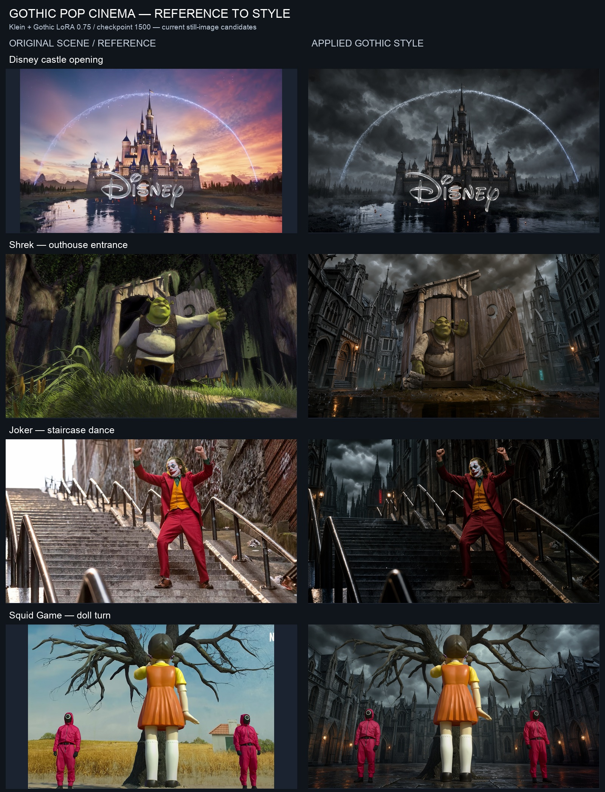
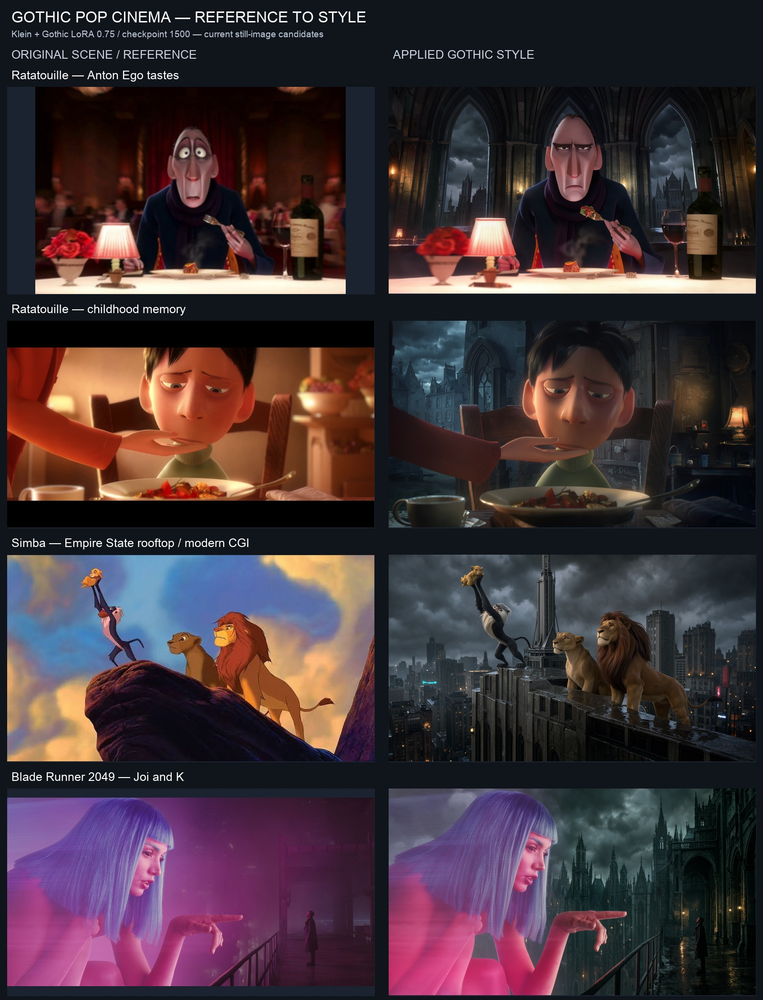
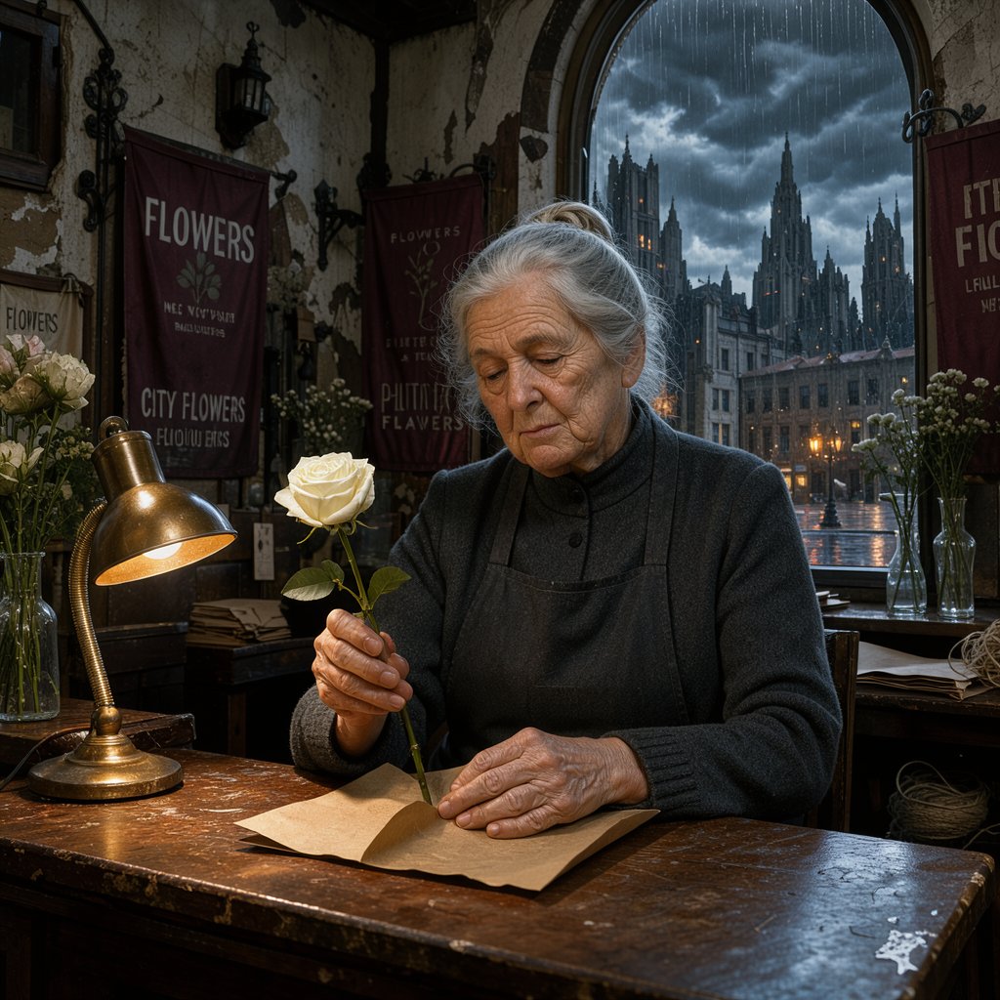

# Gothic Pop Cinema

**Recognizable scenes. One Gothic visual world.**

An experimental AI filmmaking workflow that reimagines pop-culture moments with a custom visual-style LoRA. We fine-tuned **FLUX 3 Image Klein Base** on a Nebius Serverless GPU, generate and edit keyframes with **Klein distilled**, then animate those images with **FLUX 3 Video**.

The video model does not load the LoRA: the learned look reaches the film through the keyframes.

## Results and submission status

The style adapter and still-image candidates have been generated. **12 of 16 first/end keyframes are rendered across the Disney opening and seven scenes; four endpoints are not generated.** These frames still need action/continuity review. **No video has been produced:** BFL moderated the castle and four scene requests as **Protected Content**. No completed film or public model upload is claimed here.

### Original scene → applied Gothic style

**Left: original scene/reference. Right: latest Gothic first-frame candidate.** Includes the Disney castle opening, darker Shrek and Joker, and the modern-CGI Simba rooftop treatment. All styled frames use checkpoint **1500**, adapter strength **0.75**, and were rendered at **2048×1152**.





[Open the complete comparison image](assets/scenes/original-vs-gothic.jpg) · **[View first and end frames for every scene](docs/STORYBOARD.md)** · [Sources and generation metadata](assets/scenes/provenance.json)

These are reference-to-style edits, not a controlled adapter-only comparison: some poses, framing, locations and rendering media also change. The original references are not claimed to be exact opening or ending frames. Missing endpoints are explicitly marked in the storyboard; no placeholder is presented as a generated frame.

<details>
<summary>Earlier controlled adapter-off/on comparison</summary>

| Same prompt and seed, adapter disabled | Same prompt and seed, Gothic LoRA at 0.75 |
| --- | --- |
|  |  |

Klein distilled, seed 42, 1024×1024, 16 inference steps; only adapter strength changes from 0 to 0.75. The prompt already describes a Gothic setting. [Exact prompt and settings](assets/comparison/settings.json).

</details>

## How it works

```text
Permission-cleared images + content captions
                    ↓
Klein Base → train independent style LoRA
                    ↓
Klein distilled + LoRA → hero frames → reference-linked edits
                    ↓
FLUX 3 Video image-to-video → review HD drafts
                    ↓
Selected takes → enhancement → edit + unified soundtrack
```

- **Style learning:** captions describe content; a shared trigger identifies the style.
- **Character continuity:** related shots use image references instead of unrelated text-only generations.
- **Prompt review:** expand with BFL's official prompt upsampler, inspect the caption, remove conflicting medium language and append the trigger.
- **Video control:** short, concrete actions and modest camera moves; use related start/end frames where helpful.
- **Provenance:** record model revision, seed, adapter hash, strength, prompts and source-frame hashes.
- **Multiple styles:** independent datasets, configurations and adapters, rather than mixing styles into one run.

## What is included

| File | Purpose |
| --- | --- |
| `new_style.py` | Create an isolated style workspace and training configuration |
| `validate_dataset.py` | Check image count, resolution, duplicates and captions |
| `setup_gpu.sh` | Set up a pinned AI Toolkit checkout on an existing Linux NVIDIA host |
| `run_training.sh` | Validate and train styles sequentially |
| `upsample_prompt.py` | Expand image prompts with the pinned official BFL system prompts |
| `film_pipeline.py` | Generate reference-linked frames with reviewed prompts and provenance |
| `generate_scene_videos.py` | Prepare or submit short video drafts with resumable job records |
| `bfl_video_api.py` | API helpers that keep keys out of files and reject credential-bearing redirects |
| `merge_pop_videos.py` | Assemble the seven-shot silent HD draft and verify output metadata |
| `docs/TRAINING.md` | Actual run parameters, pinned components and limitations |
| `docs/VIDEO.md` | Shot workflow, draft generation and final-edit checklist |

This is a cleaned code snapshot, separate from the live production workspace. Credentials, notebook URLs, account/project IDs, private infrastructure helpers, raw training images and model weights are deliberately excluded.

## Quick start

Python 3.10+ is required. Dataset preparation works locally; model inference and training require a compatible NVIDIA CUDA GPU, Hugging Face model access and the GPU dependencies described below. Video requests require BFL access and credits. The video/assembly scripts target macOS or Linux; ffmpeg and ffprobe are required for assembly.

```bash
python3 -m venv .venv
source .venv/bin/activate
pip install -r requirements.txt
python new_style.py my-style --trigger 'mylook style'
```

Add 20–40 permission-cleared images to `styles/my-style/data/`, each with a matching `.txt` caption describing the subject and ending with `mylook style`.

```bash
python validate_dataset.py styles/my-style/data --trigger 'mylook style'
```

On an existing Linux GPU host, place the repository under a persistent workspace. Authenticate with Hugging Face outside the repository and review installation commands before running them:

```bash
PERSISTENT_WORKSPACE=/your/persistent/workspace bash setup_gpu.sh
bash run_training.sh my-style
```

These scripts do not provision cloud resources or cap the running cost of an existing GPU. Coordinate access to a shared GPU and stop resources when appropriate after backing up outputs.

### Keyframe generation

An example manifest is included at `films/example/film.json`. Point its checkpoint at your own adapter and update the trigger. The example is an original lighthouse scene, not the submission film.

Use the GPU environment and compatible inference dependencies in [training notes](docs/TRAINING.md), then:

```bash
python film_pipeline.py --film example --phase references --operation expand
# Read films/example/prompts/hero.raw.txt and review the expanded caption.
python film_pipeline.py --film example --phase references --operation review
# Inspect/edit hero.reviewed.txt before spending GPU time on rendering.
python film_pipeline.py --film example --phase references --operation render
```

The review command only performs limited prefix cleanup and appends the trigger. It is not a substitute for human inspection. Rendering preserves existing outputs instead of silently overwriting them. Automatic in-pipeline prompt expansion is disabled because captions have already been expanded and reviewed.

### Video drafts

After generating the example frame:

```bash
python generate_scene_videos.py --film example --prepare
```

This prepares metadata without contacting the video API. To make a paid request, run interactively:

```bash
python generate_scene_videos.py --film example --submit
```

The key is entered through a hidden prompt and is not saved. Existing accepted jobs resume instead of being blindly resubmitted. Moderated or terminal requests stop; do not bypass those outcomes. A project-specific castle exclusion is retained in the batch runner. See [video notes](docs/VIDEO.md) for the seven-shot montage and final delivery.

## Dataset and limitations

The experimental run used 36 references: 25 collected through Pinterest and 11 user-supplied images. Their ownership/licensing has not been fully verified; **the dataset and adapter are not distributed in this repository**. Public availability is not training permission. Further reproduction should use owned or appropriately licensed material, and any model release needs a separate provenance and licensing review.

The run also retained sub-megapixel images and some source artifacts. These can reduce detail and create repeated visual features. The existing configuration and comparisons are documented honestly; training loss alone is not used to establish visual quality. Character identity, object contact and style consistency in motion still require review.

This is an independent experiment, not an official or endorsed production of any referenced studio or franchise. No redistribution rights to third-party works, weights or training data are granted by this repository. No blanket open-source license has been assigned; upstream dependencies retain their respective licenses.

## References

- [BFL style-to-film challenge](https://accessible-coneflower-adf.notion.site/BFL-challenge-teach-FLUX-3-Image-Klein-a-new-style-then-make-a-film-with-it-3fcc370222d5814b9fabe3cb5b71e8aa)
- [FLUX 3 Image Klein](https://docs.bfl.ai/flux_3/flux3_image_klein)
- [FLUX 3 Video](https://docs.bfl.ai/flux_3/flux3_video)
- [AI Toolkit](https://github.com/ostris/ai-toolkit)
- [Nebius hackathon environment guide](https://github.com/dariolaportanebius/nebius-starter-skill)
