# First and end frames

[Original scene → Gothic style comparison](../README.md#original-scene--applied-gothic-style) · [Full comparison image](../assets/scenes/original-vs-gothic.jpg) · [Sources and metadata](../assets/scenes/provenance.json)

**Current status: 12/16 frames rendered, 0 videos.** This includes the Disney opening and seven scenes. These are work-in-progress stills, not animation-ready approvals. BFL rejected the castle and four scene video requests for Protected Content; blocked requests are not being retried.

The tables below show **first frame on the left, end frame on the right**. “Not generated” means no endpoint exists; it is not a hidden image or a completed render. Images are resized previews of the actual 2048×1152 outputs, using checkpoint 1500 at LoRA strength 0.75.

## 00 — Disney castle opening

Planned motion: restrained camera push, mist, water ripples and subtle shimmer along the existing arc. The arc is already complete in the first frame; this is not an animation of it being drawn.

| First frame | End frame |
| --- | --- |
| 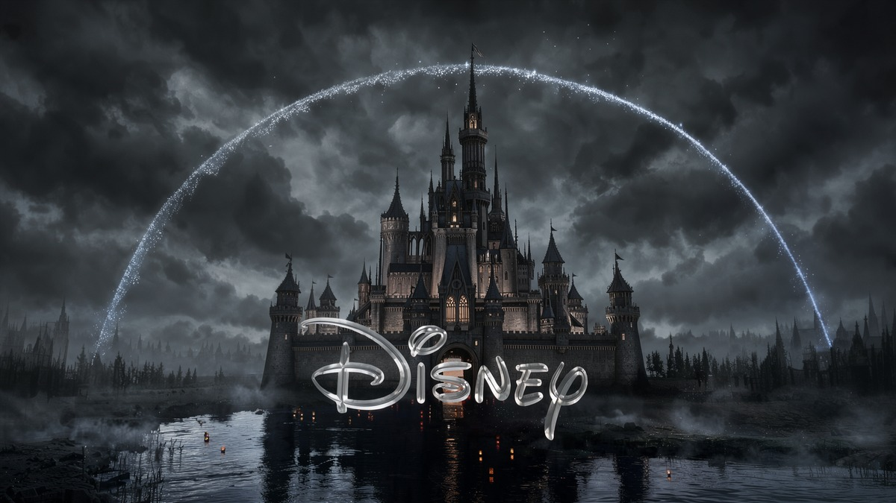 | **Not generated.** |

## 01 — Shrek: outhouse entrance

Intended action: push the door open and finish in the original outstretched-arm pose. Latest look: darker olive skin, dirtier clothing, restrained neon. **The door/starting pose still needs review before animation.**

| First frame | End frame |
| --- | --- |
| 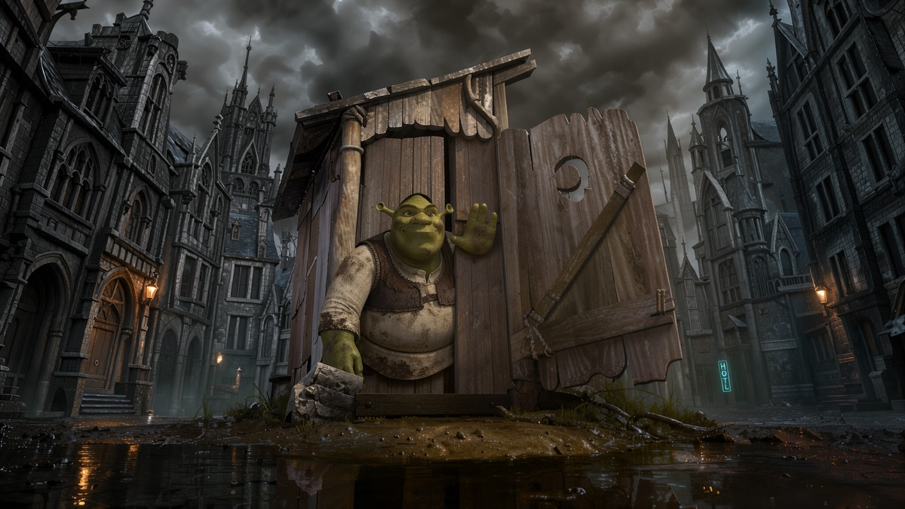 | **Not generated.** |

## 02 — Joker: staircase dance

Intended action: the original descending staircase dance. Latest look: darker crimson suit and a small distant neon sign.

| First frame | End frame |
| --- | --- |
| 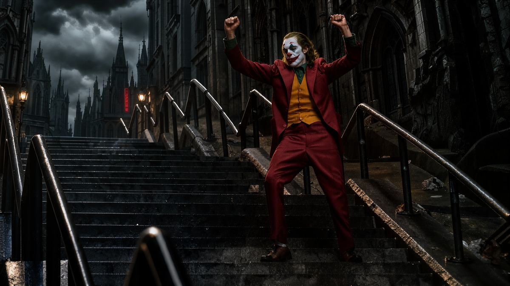 | **Not generated.** |

## 03 — Squid Game: doll turn

Intended action: Young-hee turns her head toward the players while her torso and the guards remain still. The paired candidates require continuity review, not just a face-direction check.

| First frame | End frame |
| --- | --- |
| 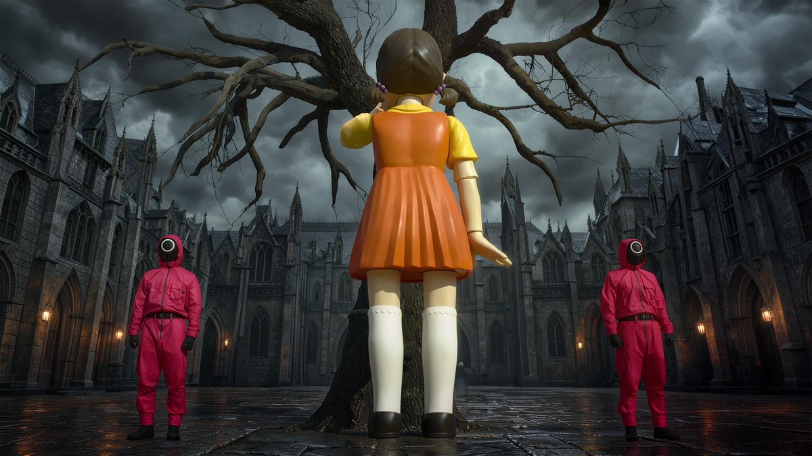 | 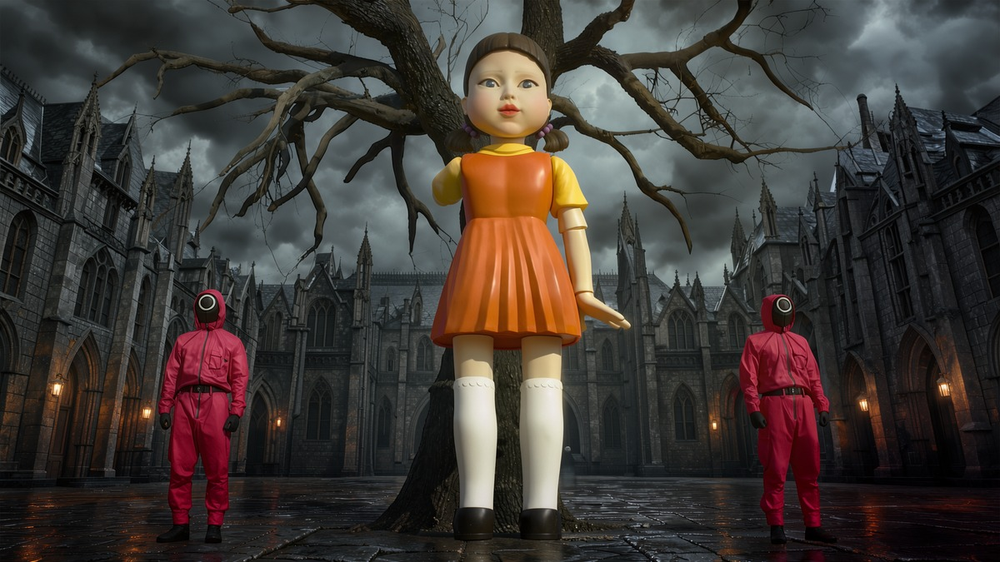 |

## 04 — Ratatouille: Anton Ego tastes

Intended action: one bite, then stunned recognition. **Known defect: food remains on the fork in the ending candidate; the bite/contact continuity is not correct yet.**

| First frame | End frame |
| --- | --- |
| 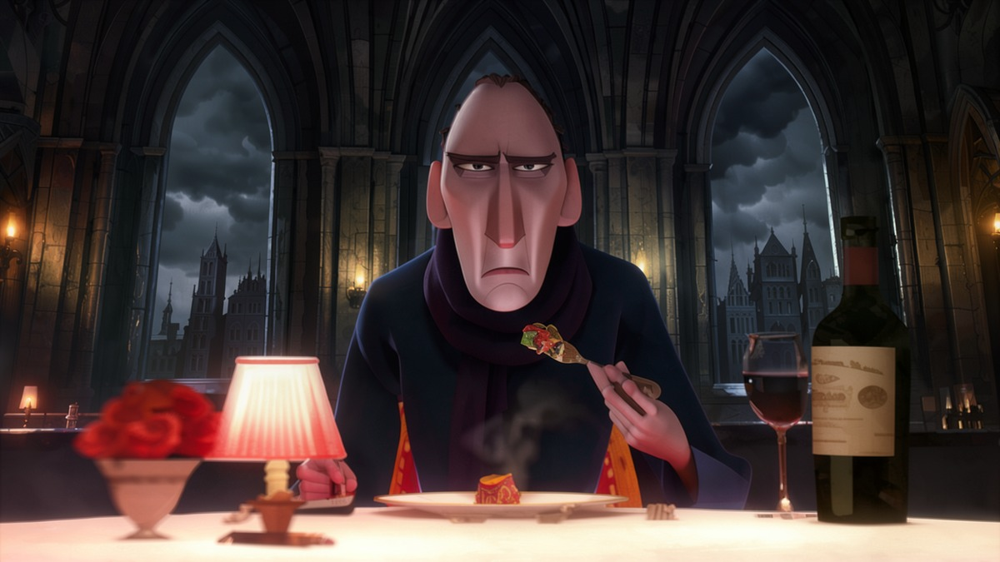 | 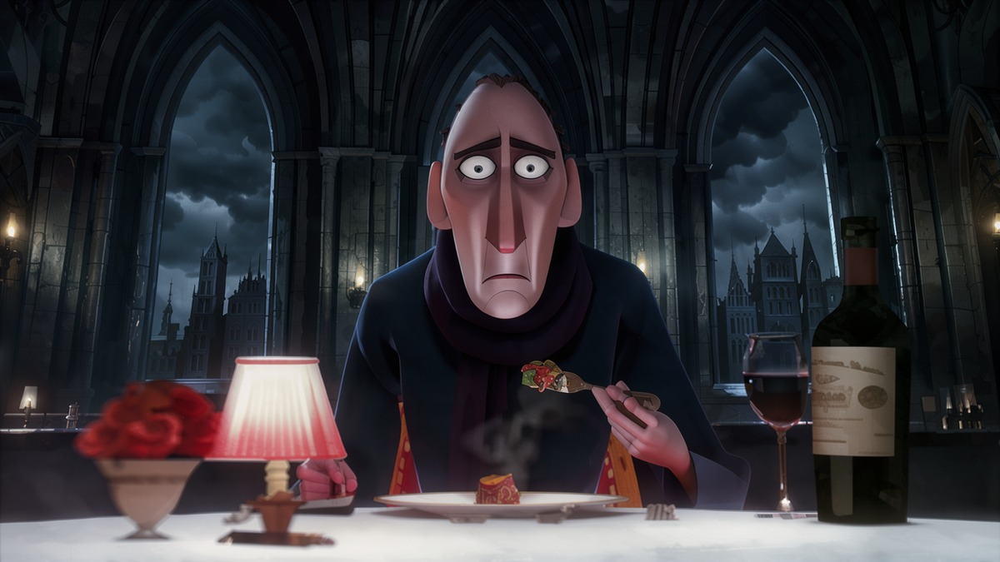 |

## 05 — Ratatouille: childhood memory

Intended action: his mother gently lifts his chin; young Ego looks up and his expression softens. Keep this separate from the adult shot, not an age-morph transition.

| First frame | End frame |
| --- | --- |
| 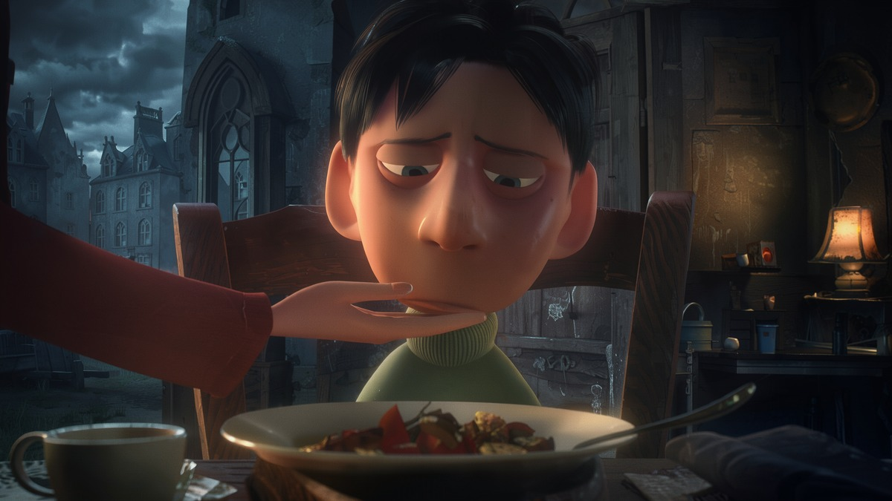 | 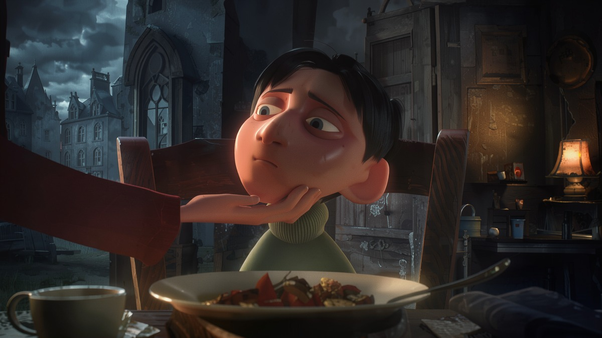 |

## 06 — Simba: Empire State rooftop

Requested treatment: modern CGI animals, the user's low-angle side composition, and the presentation atop the Empire State Building in a Gothic city. Rafiki is left, Sarabi middle and Mufasa right. **Known defect: the current first-frame candidate already shows Simba raised overhead, so it cannot serve as the before-lift pose.**

| First frame | End frame |
| --- | --- |
| 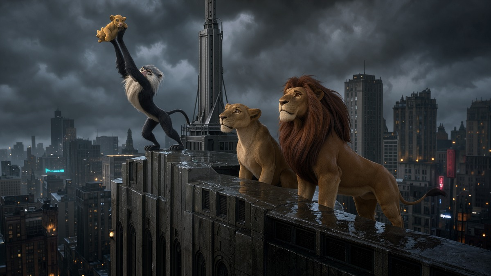 | **Not generated.** |

## 07 — Blade Runner 2049: Joi and K

Intended action: Joi inclines toward K with the original hand gesture; K remains still. **The current ending candidate advances the action only slightly; the pair needs further review.**

| First frame | End frame |
| --- | --- |
| 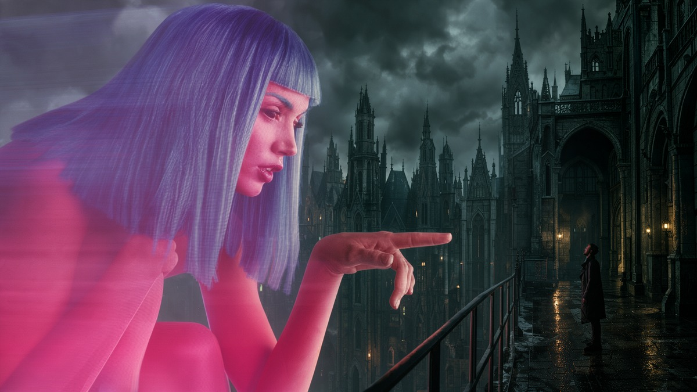 | 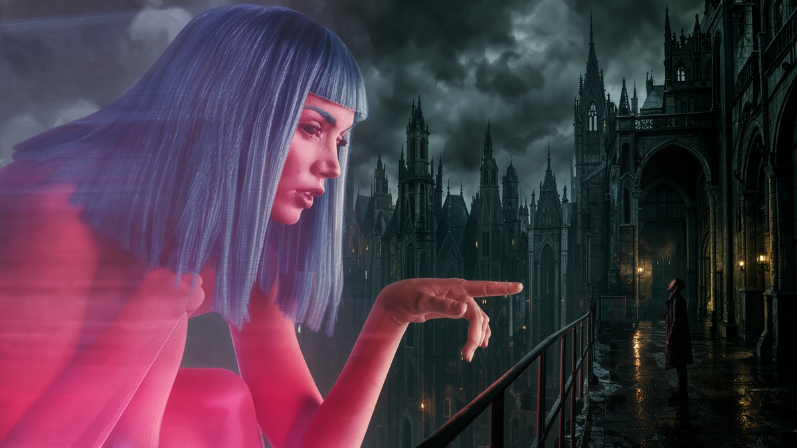 |

## Reference credits

The Disney opening and Simba composition references were supplied by the user. Other public reference sources include [Shrek](https://cardiff.shorthandstories.com/-shrek-month-therapy/index.html), [Joker — official DC gallery](https://www.dc.com/movies/joker-2019), [Squid Game](https://www.revistacentral.com.mx/en-corto/el-juego-del-calamar-la-historia-detras-de-la-serie), [Ego's tasting scene](https://spoonuniversity.com/school/west-chester/a-ranking-of-the-most-iconic-food-moments-in-movie-history/) and [Joi and K](https://dailyhive.com/vancouver/blade-runner-2049-visual-effects-vancouver). The complete per-image provenance, including the childhood-memory reference, is in [provenance.json](../assets/scenes/provenance.json).

Film references, characters and marks belong to their respective rights holders. This independent experiment is not endorsed by the studios and does not grant rights to reuse third-party material. Reference editing and previews are distinct from the training dataset.
